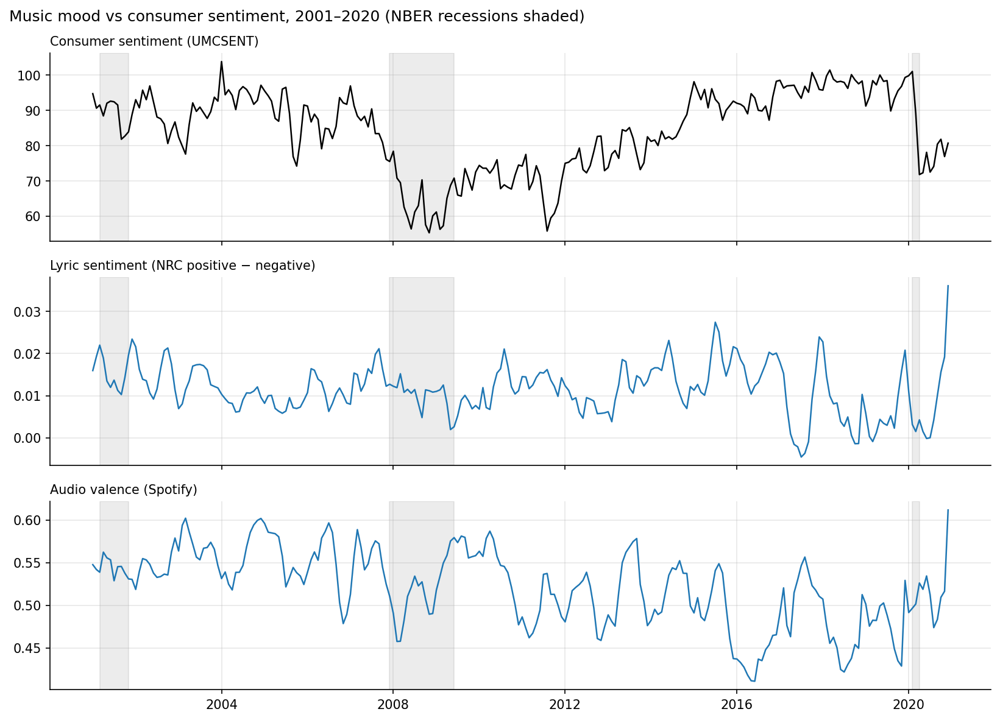
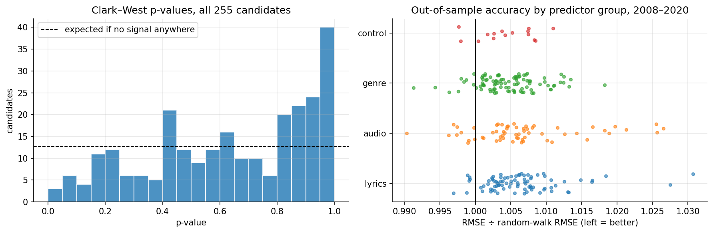
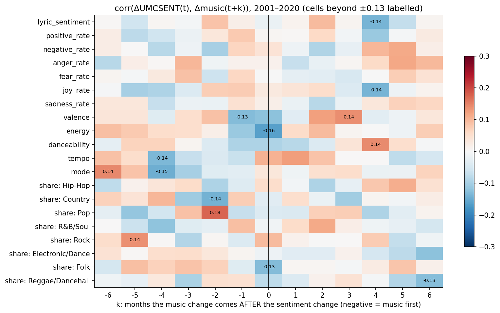

# RecessionPop

**Can the mood of the Billboard Hot 100 help forecast U.S. consumer sentiment?**

This project builds a monthly "music mood" signal for 2001–2020 from what Americans were actually listening to. Every Hot 100 chart entry is weighted by its rank, and each song is described by three things:

- **lyrics**: the share of words the NRC Emotion Lexicon tags as positive or negative, plus fear, joy, sadness and the other NRC emotions;
- **sound**: Spotify valence, energy, danceability, tempo and mode;
- **genre**: an audited genre taxonomy built from Spotify niche tags.

The signal is then tested in both directions against the University of Michigan Consumer Sentiment Index: does music *lead* sentiment, and does sentiment *lead* music?



## Result: chart mood and consumer sentiment move independently

Over 2001–2020, the music signal doesn't lead sentiment, doesn't follow it, and doesn't move with it in the same month. The tests had enough power to detect modest effects in both directions.

### Does music lead sentiment? No

UMCSENT behaves like a random walk, so the bar to beat is "next month equals this month." I screened **255 candidate predictors**:

- 7 lyric emotions, 5 audio features, and 8 genre chart shares;
- each as a level, a 1-month change, a 3-month change, and a gap from its 12-month average;
- each at lags of 1, 3 and 6 months;
- plus inflation expectations and past sentiment changes as reference controls.

Every candidate was tested with rolling-origin forecasts over 2008–2020, refitting each month on past data only. The comparison used Clark–West tests against the random walk, with a Benjamini–Hochberg correction.

- **None survives the correction** (best q ≈ 1.0). Only 3 of 255 reach raw p < .05, where pure chance would produce about 13.
- **Joint models do worse** than the random walk: all lyrics, all audio, genre mix, and everything combined.
- **The test can detect real signals.** A planted predictor with a true R² of 5% is detected 81% of the time under the same protocol, so any music effect at a one-month horizon is smaller than that.
- **The economic controls don't beat the random walk either.** Month-to-month sentiment changes are mostly unpredictable surprises.



### Does sentiment lead music? Also no

The roles are flipped: can past sentiment changes forecast monthly changes in the 20 music series, beyond each series' own history (AR(2))? The test uses the same rolling protocol and corrections, with sentiment at lags of 1, 3 and 6 months or as a 3-month change.

- **1 of 80 variants** reaches raw p < .05 (about 4 expected by chance), and the best q is 0.98.
- **Granger tests in both directions,** in-sample: there are no sentiment→music hits at raw p < .05 among the 20 series. Music→sentiment has 2 raw hits, and neither survives correction.
- **Cross-correlations:** same-month correlations are all near zero. Of 260 lead/lag correlations, 14 fall outside the 95% band, against about 13 expected by chance, with no pattern.
- **Power:** a planted 5% effect is detected 83% of the time.



### What this doesn't rule out

- Slower, year-scale cultural shifts. Twenty years gives only about 20 independent annual points.
- Effects confined to specific groups, such as new releases rather than the whole chart.
- Signals that need better lyric models than a word lexicon.

See Sections 6–8 of the notebook.

## Project layout

```
src/recessionpop/      data pipeline + modelling (importable package)
  config.py            paths, analysis window, constants
  load.py              raw-data loaders
  genres.py            genre engineering rules
  matching.py          Billboard -> Spotify deterministic matcher
  lyrics.py            NRC lexicon lyric scoring
  features.py          rank-weighted weekly/monthly signals, coverage, genre shares
  modeling.py          stationarity checks, random-walk baseline, augmented models
  predictors.py        255-candidate rolling-origin screen, music -> sentiment
  reverse.py           sentiment -> music tests, two-way Granger, cross-correlations
  pipeline.py          end-to-end build -> data/processed/model_data.parquet
notebooks/
  recessionpop_analysis.ipynb   the analysis (generated by scripts/build_notebook.py)
docs/decisions.md      why each matching / genre / window rule exists
reports/figures/       charts saved by the notebook
archive/               earlier notebook iterations and original zip downloads
```

## Reproduce

1. Put the raw files in `data/raw/`:

   | File | Source |
   |---|---|
   | `hot100.csv` | Billboard Hot 100 weekly charts (Ludmin dataset) |
   | `songs.csv` | *550K Spotify Songs: Audio, Lyrics & Genres* (Kaggle) |
   | `NRC-Emotion-Lexicon.zip` | [NRC Emotion Lexicon](https://saifmohammad.com/WebPages/NRC-Emotion-Lexicon.htm) |
   | `UMCSENT_consumersentiment.csv` | FRED [`UMCSENT`](https://fred.stlouisfed.org/series/UMCSENT) |
   | `MICH_inflation.csv` | FRED [`MICH`](https://fred.stlouisfed.org/series/MICH) |

2. Install dependencies and build the data. The first run caches intermediate Parquet files in `data/processed/`. Add `--force` to rebuild them.

   ```bash
   pip install -r requirements.txt
   ```

   ```bash
   PYTHONPATH=src python -m recessionpop.pipeline
   ```

3. Open `notebooks/recessionpop_analysis.ipynb`. To edit it, change `scripts/build_notebook.py`, then regenerate and execute:

   ```bash
   python scripts/build_notebook.py && jupyter nbconvert --to notebook --execute --inplace notebooks/recessionpop_analysis.ipynb
   ```

## Limitations

- Only 36.7% of unique Hot 100 songs match the 550K catalogue, so the matcher deliberately avoids fuzzy matching. In rank-weighted terms, 2001–2020 coverage averages 54%. It collapses after 2020, which caps the analysis window.
- Lexicon-based lyric scoring ignores context, negation and irony.
- With one 2017–2020 test split, the evaluation includes the COVID shock, which no music signal could plausibly anticipate.
